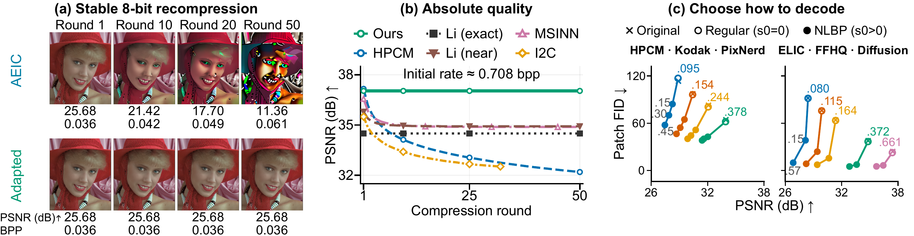

# Your Codec, Your Generator: Idempotent Generative Compression without Retraining

<p align="center">
Raz Haim and Assaf Shocher, Technion - Israel Institute of Technology
<br><br>
<a href="https://arxiv.org/abs/2611.31520">Paper (arXiv)</a> | <a href="https://assafshocher.github.io/your-codec/">Project page</a>
</p>



*(a) An image after 1, 10, 20 and 50 recompressions, with and without our adapter. (b) PSNR across recompression
rounds against methods designed for idempotency, at a common initial bitrate, on Kodak. (c) Nonlinear back-projection
controls the perception-distortion trade-off: each curve varies the decoding while the transmitted bitstreams stay
fixed.*

A frozen, pretrained learned image codec becomes **idempotent under recompression, without any training**: decoding
and re-encoding returns the same compressed code, round after round. The same bitstream can also be decoded by a frozen generative
prior of your choice (**NLBP**, nonlinear back-projection). Tested on eight codecs: AEIC, HPCM, ELIC, MS-ILLM,
Hyperprior, Mean-scale, TCM and GLC.

## How it works

We wrap the codec's encoder $`E`$ with a fixed linear map built from a patch-PCA basis (the only fitted component):

```math
E'(x) = f(b(x)) + c\,a(x).
```

It has an exact write $`W(v, b)`$ with $`E'(W(v, b)) = v`$, so the decoder can always produce an image that re-encodes
to the received symbols. For 8-bit storage, a repair step searches for a stored image that re-encodes exactly, with an
escalation ladder of larger budgets. NLBP samples from a frozen prior and corrects every step with the same write:

```math
\begin{aligned}
v_t^+ &= (1 - \lambda_t)\,y_t + \lambda_t\,y^\star,
\\ b_t^+ &= b(u_t) + \kappa\lambda_t\,\big[r_{\mathrm{ref}} - b(D_{\mathrm{ref}}(y_t))\big],
\\ u_t^+ &= W(v_t^+, b_t^+),
\end{aligned}
```

where $`u_t`$ is the prior's clean estimate, $`y_t = E'(u_t)`$ and $`y^\star`$ the target selected from the received
symbols. A codec plugs in through a small adapter (`adapters/<codec>/`); everything else is codec-agnostic.

## Install

Install PyTorch 2.x with CUDA and the matching torchvision first, then

```
pip install -r requirements.txt
```

- AEIC also needs `pip install diffusers==0.25.1 peft==0.13.2 pytorch_lightning==2.4.0` and its coder:
  `PYBIN=python bash scripts/build_aeic_coder.sh`.
- NLBP with PixNerd, Z-Image or FLUX.2 [dev] needs a second Python environment for the priors
  ([details](docs/DETAILS.md#install)).
- Weights and data are not included: [where to get them and where to put them](docs/DETAILS.md#weights-and-data-not-included).
- Bit-exact reproduction of the reported files needs the GPU type of the original runs (RTX PRO 6000, B200).

## Quick start

```
python tests/cpu_selftest.py
python scripts/run_chain.py --config configs/hyperprior_kodak_8bit.yaml --rate 2 --images kodim01 --rounds 50 \
    --data data/kodak --out runs/demo
```

The self-test needs no downloads. The chain needs Kodak in `data/kodak` (the Hyperprior weights download
automatically) and writes a `rows.csv` per chain, one row per round; `file_eq_g1` and `img_eq_g1` report whether the file and
the image still equal round 1.

## Reproduce the paper

```
python scripts/run_chain.py --config configs/<variant>.yaml --rate <rate> --images kodim01,kodim02 --rounds 50 \
    --data data/kodak --out runs/<variant>
python evaluation/score_chains.py --chains runs/<variant>/<method> --orig-dir data/kodak --rounds 1,50 \
    --codec <codec> --protocol kodak64 --out runs/score_<variant>
```

| Results | Configs |
|---|---|
| 8-bit recompression, Kodak | `aeic_kodak_8bit`, `hpcm_kodak_8bit_ladder`, `elic_kodak_8bit`, `msillm_kodak_8bit`, `hyperprior_kodak_8bit`, `mean_scale_kodak_8bit`, `tcm_kodak_8bit`, `tcm_kodak_8bit_box` |
| 8-bit recompression, 2K and 256 x 256 | `aeic_div2k_8bit`, `aeic_clic_8bit`, `elic_256_8bit` |
| Float and clipped-float recompression | `aeic_kodak_float`, `hpcm_kodak_float`, `elic_kodak_float`, `glc_kodak_float`, `aeic_div2k_float`, `aeic_kodak_clipped_float`, `hpcm_kodak_clipped_float` |
| NLBP (runner `scripts/run_nlbp.py`) | `nlbp/configs/elic_ffhq_rate<r>.yaml`, `nlbp/configs/hpcm_kodak_*.yaml` |

`--rounds 50` = 1 compression + 49 recompressions; the rates are listed in each config. HPCM: with the escalation
ladder all 144 chains are file-exact and image-exact over 50 rounds (the paper's 137/144 row used an older
stabilization step). The full variant table, the plain-codec baselines and the metrics are in
[docs/DETAILS.md](docs/DETAILS.md#reproduce).

NLBP examples (first decode):

```
python scripts/run_nlbp.py --config nlbp/configs/elic_ffhq_rate4.yaml --images 00000,00001 --data data/ffhq256 --out runs/nlbp
python scripts/run_nlbp.py --config nlbp/configs/hpcm_kodak_pixnerd_s045.yaml --images kodim01 --data data/kodak --out runs/nlbp
```

## Layout

```
adapted_codec/   codec-agnostic core: wrapper, target search, acceptance, repair, storage protocols, chains
adapters/        one adapter per codec
nlbp/            NLBP: update, sampler, final write, prior adapters, configurations
configs/         one yaml per reported variant
evaluation/      PSNR, MS-SSIM, LPIPS, DISTS, patch FID / KID, payload bpp
scripts/         runners and data preparation
tests/           self-test and comparisons with stored reference rounds
third_party/     upstream code, each with its own licence
docs/DETAILS.md  notation and code names, weights and data, every variant, NLBP details, tests
```

## Licence

Our code: MIT (`LICENSE`). Code under `third_party/` keeps its own licence.

## Citation

```bibtex
@article{haim2026yourcodec,
  title   = {Your Codec, Your Generator: Idempotent Generative Compression without Retraining},
  author  = {Haim, Raz and Shocher, Assaf},
  journal = {arXiv preprint arXiv:2611.31520},
  year    = {2026}
}
```
